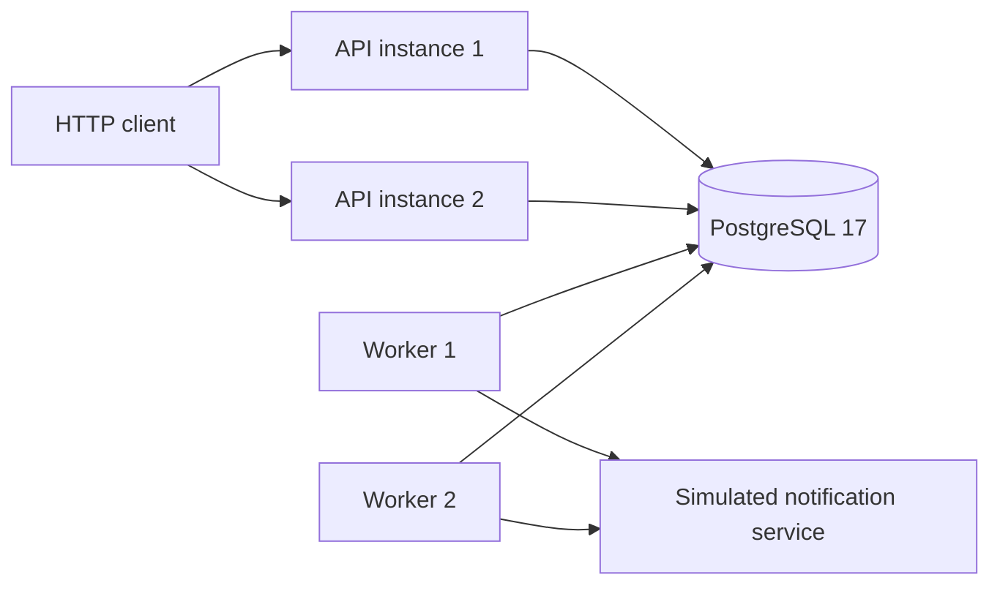
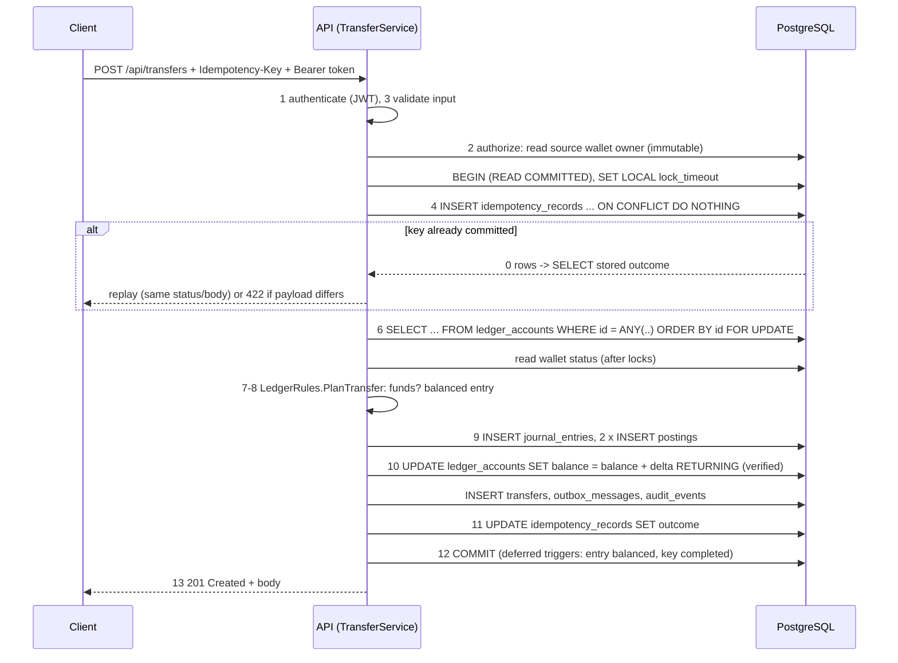

# LedgerCore architecture

This document explains how LedgerCore is built and *why*, with references into the code. Decisions with real alternatives are recorded separately as ADRs in [../decisions](../decisions).

## 1. Shape of the system

A **modular monolith**: one deployable API (scalable horizontally), one background worker, one PostgreSQL database.



API instances share **nothing but the database**. Every correctness guarantee therefore lives either in PostgreSQL (constraints, row locks, unique keys, triggers) or in code that runs inside a single PostgreSQL transaction. There is no in-process lock, cache or dictionary that correctness depends on.

### Projects and dependency rules

| Project | Responsibility | May depend on |
|---|---|---|
| `LedgerCore.Domain` | Money, currencies, accounts, journal entries, the rules of transfers/funding/reversals. Pure functions, no I/O. | nothing |
| `LedgerCore.Application` | Use cases (`TransferService`, `FundingService`, `ReversalService`, `WalletService`, `ReconciliationService`), idempotency skeleton, authorization policy, ports (interfaces) for persistence | Domain |
| `LedgerCore.Infrastructure` | EF Core model + migrations, the Npgsql transaction engine, read queries, outbox dispatcher | Application, Domain |
| `LedgerCore.Api` | HTTP: authentication, authorization policies, rate limiting, JSON strictness, error mapping, correlation ids, health, OpenAPI, failure-injection headers | Application, Infrastructure |
| `LedgerCore.Worker` | Background services: outbox delivery, idempotency retention cleanup, scheduled reconciliation | Application, Infrastructure |

The ports in [ILedgerTransaction.cs](../../src/LedgerCore.Application/Abstractions/ILedgerTransaction.cs) are the only abstraction layer: `ILedgerTransactionRunner` / `ILedgerTransaction` (write path), `ILedgerReadStore` (reads), `IWalletRegistry`, `IAuditLog`, `IFailureInjector`. Each has exactly one production implementation. They exist because they mark the boundary between "what the transfer does" (Application, readable as a numbered algorithm) and "how PostgreSQL does it" (Infrastructure, explicit SQL). There are deliberately no generic repositories.

## 2. Accounting model

Double-entry bookkeeping with an explicit chart of accounts ([ChartOfAccounts.cs](../../src/LedgerCore.Domain/Ledger/ChartOfAccounts.cs)):

| Account | Type | Normal balance | Meaning |
|---|---|---|---|
| `2100-WALLET-{walletId}` | Liability | Credit | What the simulated system owes one customer. Never negative. |
| `5900-SIM-FUNDING-NOK` | Expense | Debit | Counter-account for simulated deposits. |

| Operation | Debit | Credit |
|---|---|---|
| Transfer A → B | A's wallet liability (we owe A less) | B's wallet liability (we owe B more) |
| Simulated funding of W | Funding expense | W's wallet liability |
| Reversal of a transfer | B's wallet liability | A's wallet liability |

Conventions: amounts are `long` **minor units** (øre); every posting amount is strictly positive and the side is carried by `direction`; one currency per journal entry; all timestamps are UTC.

Accounting identity maintained by every entry: Σ(debit-normal balances) = Σ(credit-normal balances), i.e. total funding expense = total of all wallet balances. The load test checks this end to end; the randomized unit test checks it after each of 9 000 domain operations.

### Source of truth vs projection

* **Source of truth:** `journal_entries` + `postings`, append-only (enforced by triggers).
* **Projection:** `ledger_accounts.balance_minor`, updated **in the same transaction** as the postings, so that balance checks are O(1) and can be done on a locked row.
* **Drift detection:** reconciliation recomputes every balance from postings (section 7).

## 3. Data model

```
customers (id PK)
ledger_accounts (id PK, code UNIQUE, account_type, normal_balance, currency, allow_negative_balance, balance_minor, version)
    UNIQUE (id, currency)                         -- target of composite FKs
    CHECK allow_negative_balance OR balance_minor >= 0
wallets (id PK, customer_id FK, ledger_account_id UNIQUE, currency, status)
    FK (ledger_account_id, currency) -> ledger_accounts (id, currency)
journal_entries (id PK, entry_type, currency, description, reverses_journal_entry_id UNIQUE NULL FK, created_by, correlation_id)
    UNIQUE (id, currency)
    CHECK (entry_type = 'Reversal') = (reverses_journal_entry_id IS NOT NULL)
postings (id identity PK, journal_entry_id, ledger_account_id, direction, amount_minor > 0, currency)
    FK (journal_entry_id, currency) -> journal_entries (id, currency)    -- posting currency = entry currency
    FK (ledger_account_id, currency) -> ledger_accounts (id, currency)   -- posting currency = account currency
transfers (id PK, journal_entry_id UNIQUE FK, from_wallet_id, to_wallet_id, amount_minor > 0, …)  CHECK from <> to
transfer_reversals (id PK, transfer_id UNIQUE FK, journal_entry_id UNIQUE FK, reason, requested_by)
idempotency_records (PK (principal_id, operation, idempotency_key), request_hash, succeeded, response_body jsonb, expires_at)
audit_events (id identity PK, occurred_at, actor_id, action, outcome, resource_type, resource_id, correlation_id, details jsonb)
outbox_messages (id PK, message_type, payload jsonb, available_at, attempt_count, locked_until, locked_by, processed_at, dead_lettered_at, last_error)
simulated_notifications (message_id PK, …, delivery_count)   -- the "external" consumer's inbox
```

Table definitions: [ModelConfiguration.cs](../../src/LedgerCore.Infrastructure/Persistence/ModelConfiguration.cs). The hand-written integrity layer (triggers) is in the [LedgerIntegrityRules migration](../../src/LedgerCore.Infrastructure/Persistence/Migrations/20261014212958_LedgerIntegrityRules.cs):

| Trigger | Effect |
|---|---|
| `*_append_only`, `*_no_truncate` on journal_entries, postings, transfers, transfer_reversals, audit_events | UPDATE/DELETE/TRUNCATE raise `23000` |
| `journal_entries_must_balance`, `postings_must_balance` (DEFERRABLE INITIALLY DEFERRED) | At COMMIT, each new entry must have ≥ 2 postings and Σdebits = Σcredits |
| `idempotency_records_must_complete` (deferred) | An idempotency record cannot commit without a stored outcome |
| `ledger_accounts_definition_immutable`, `wallets_definition_immutable` | Only `balance_minor`/`version`/`updated_at` and wallet `status` may change |

## 4. The transfer transaction

`POST /api/transfers` → [LedgerEndpoints.CreateTransfer](../../src/LedgerCore.Api/Endpoints/LedgerEndpoints.cs) → [TransferService.CreateAsync](../../src/LedgerCore.Application/Transfers/TransferService.cs:45).



| Step (spec) | Code |
|---|---|
| 1 Authenticate | JWT bearer middleware, [AuthenticationSetup.cs:62](../../src/LedgerCore.Api/Security/AuthenticationSetup.cs:62) |
| 2 Authorize | `WalletAccessPolicy.CanDebit` in [TransferService.cs:82](../../src/LedgerCore.Application/Transfers/TransferService.cs:82); re-checked on locked rows in [LedgerRules.cs:18](../../src/LedgerCore.Domain/Ledger/LedgerRules.cs:18) |
| 3 Validate | Strict JSON (`ApiSetup`) + `TransferService.Validate` |
| 4-5 Idempotency + transaction | [IdempotentCommandExecutor.cs:28](../../src/LedgerCore.Application/Idempotency/IdempotentCommandExecutor.cs:28), [NpgsqlLedgerTransaction.cs:23](../../src/LedgerCore.Infrastructure/Ledger/NpgsqlLedgerTransaction.cs:23) |
| 6 Lock | [NpgsqlLedgerTransaction.cs:89](../../src/LedgerCore.Infrastructure/Ledger/NpgsqlLedgerTransaction.cs:89) |
| 7-8 Funds + balanced entry | [LedgerRules.cs:18](../../src/LedgerCore.Domain/Ledger/LedgerRules.cs:18), [JournalEntry.cs:66](../../src/LedgerCore.Domain/Ledger/JournalEntry.cs:66) |
| 9 Postings | [NpgsqlLedgerTransaction.cs:168](../../src/LedgerCore.Infrastructure/Ledger/NpgsqlLedgerTransaction.cs:168) |
| 10 Projection | [NpgsqlLedgerTransaction.cs:212](../../src/LedgerCore.Infrastructure/Ledger/NpgsqlLedgerTransaction.cs:212) |
| 11 Store outcome | [NpgsqlLedgerTransaction.cs:69](../../src/LedgerCore.Infrastructure/Ledger/NpgsqlLedgerTransaction.cs:69) |
| 12 Commit / retry | [NpgsqlLedgerTransactionRunner.cs:22](../../src/LedgerCore.Infrastructure/Ledger/NpgsqlLedgerTransactionRunner.cs:22) |
| 13 Response | [HttpResults.cs](../../src/LedgerCore.Api/Http/HttpResults.cs) (`201`, or identical replay + `Idempotent-Replayed: true`) |

Note on step ordering: the specification lists "check idempotency" before "start a transaction". LedgerCore merges them: the check *is* the first statement of the transaction. A check before the transaction would race with a concurrent duplicate; the primary-key insert inside the transaction cannot.

## 5. Concurrency design

* **Isolation level: READ COMMITTED** plus explicit row locks ([ADR-0003](../decisions/0003-locking-strategy.md)). Balance decisions are made only on rows returned by `SELECT … FOR UPDATE`, which in PostgreSQL always returns the latest committed version of a locked row.
* **Deterministic lock ordering:** all ledger accounts a command touches are locked in **one** statement, `ORDER BY id`. Every transaction acquires its row locks in the same global order, so a wait-for cycle between two ledger transactions cannot form. The idempotency key (also a lock, on the PK index) is always taken first and is unique per transaction, so it cannot participate in a cycle either.
* **Bounded waiting:** `SET LOCAL lock_timeout = 5s` ([runner:72](../../src/LedgerCore.Infrastructure/Ledger/NpgsqlLedgerTransactionRunner.cs:72)). A timeout becomes `503 LOCK_TIMEOUT` with `Retry-After`; the client retries with the same key.
* **Retries:** `40001`, `40P01` and connection-level failures (Npgsql `IsTransient`, e.g. `57P01`) re-run the whole transaction up to 4 attempts with exponential backoff + jitter ([TransientFailures.cs](../../src/LedgerCore.Infrastructure/Ledger/TransientFailures.cs)). Retrying is safe even if COMMIT's outcome was unknown, because the retry starts by claiming the same idempotency key.
* **Database backstops:** `CHECK (balance_minor >= 0)` and the `RETURNING` comparison in `ApplyBalanceChangesAsync` turn any bug in the locking logic into a rolled-back transaction rather than wrong money.

**What happens with two simultaneous 800 NOK spends from 1 000 NOK?** Request 1 locks the account row and reads 1 000. Request 2's `FOR UPDATE` blocks on that row. Request 1 debits to 200 and commits. Request 2 is granted the lock, re-reads the *committed* row (200), and is rejected with `INSUFFICIENT_FUNDS`. `OverspendTests.The_second_spend_blocks_on_the_row_lock_then_sees_the_committed_balance` reproduces exactly this interleaving deterministically, using a checkpoint gate. It also proves via `pg_stat_activity` that request 2 waited on a PostgreSQL row lock. `LostUpdateDemonstrationTests` shows what happens *without* the lock: 80 000 øre is created out of thin air.

## 6. Idempotency

| Aspect | Decision |
|---|---|
| Header | `Idempotency-Key`, 8-128 chars of `[A-Za-z0-9-_.:]`, required on all money-moving POSTs |
| Uniqueness scope | `(principal_id, operation, key)`: per caller and per operation type |
| Fingerprint | SHA-256 of canonical JSON of the *validated* request ([IdempotencyTypes.cs](../../src/LedgerCore.Application/Idempotency/IdempotencyTypes.cs)) |
| Same key + same payload | Stored outcome replayed: identical status and body, plus `Idempotent-Replayed: true` |
| Same key + different payload | `422 IDEMPOTENCY_KEY_REUSED`, nothing executed |
| What is stored | Successes **and** business rejections decided under lock (e.g. `INSUFFICIENT_FUNDS`). Not stored: malformed input, auth failures, transient failures (nothing was decided) |
| Concurrency | The `INSERT … ON CONFLICT DO NOTHING` of a duplicate waits for the first transaction to commit or roll back (unique-index wait), then reads the committed outcome |
| Durability | In the same database transaction as the transfer; survives restarts (tested with a new host and with a real process kill) |
| Retention | 24 h (`Idempotency:Retention`); the worker deletes expired records hourly in batches. After that a key is reusable |

## 7. Reconciliation

[LedgerReadStore.ComputeReconciliationAsync](../../src/LedgerCore.Infrastructure/Queries/LedgerReadStore.cs:106) runs four queries in one `REPEATABLE READ READ ONLY` transaction (one snapshot): per-account cached vs. recomputed balance, global Σdebits vs. Σcredits, unbalanced entries, negative wallets. Because postings and projections are always updated in the same transaction, a correct ledger reconciles exactly even while transfers are running.

**If the cached balance differs from the journal**, the journal is right by definition. [ReconciliationService](../../src/LedgerCore.Application/Reconciliation/ReconciliationService.cs:35) does **not** rewrite the cache, because that would erase the evidence of whatever bug or tampering caused it. It:
1. reports the discrepancy (API response),
2. logs an error per account and increments `ledgercore.reconciliation.discrepancies`,
3. writes an audit event, and
4. by default **freezes** the affected wallets, so no one can spend a balance that may be inflated. Transfers from or to a frozen wallet are rejected with `WALLET_NOT_ACTIVE`.

Recovery (rebuilding the projection after investigation, unfreezing) is an operator procedure that is documented but not implemented as an endpoint.

## 8. Transactional outbox

The transfer transaction inserts an `outbox_messages` row, so a notification exists if and only if the transfer committed. [OutboxDispatcher](../../src/LedgerCore.Infrastructure/Outbox/OutboxDispatcher.cs:55):

1. **Lease** a batch: `UPDATE … SET locked_until = now()+lease, locked_by = worker, attempt_count = attempt_count+1 WHERE id IN (SELECT … FOR UPDATE SKIP LOCKED)`. Concurrent workers skip each other's rows.
2. **Deliver** outside any transaction.
3. **Acknowledge** (`processed_at`), or **reschedule** with exponential backoff (`available_at`), or **dead-letter** after `MaxAttempts`.

A worker that crashes between 2 and 3 leaves a lease that expires, and the message is delivered again. That makes delivery **at-least-once**, not exactly-once. The consumer ([DatabaseNotificationSink](../../src/LedgerCore.Infrastructure/Outbox/OutboxDispatcher.cs:190)) is idempotent: `message_id` is its primary key and duplicates only increment `delivery_count`. Transaction atomicity (the ledger change and the outbox row commit together) is a different guarantee from delivery (the message reaches the consumer at least once). The ledger stays correct even if every worker is down.

## 9. Failure matrix

| Failure | What happens | Verified by |
|---|---|---|
| Exception before COMMIT (any checkpoint) | `await using` disposes the open transaction → ROLLBACK; key not committed; retry executes fresh | `FailureInjectionTests.Scenario_A_and_D…` (4 checkpoints) |
| **Process killed** before COMMIT | Server sees the connection drop → aborts the transaction | `ProcessCrashTests.Scenario_A…` (real process kill) |
| Exception / **process killed** after COMMIT | Transfer durable; client got no response; retry with the same key replays | `FailureInjectionTests.Scenario_B…`, `ProcessCrashTests.Scenario_B…` |
| DB connection killed between postings | `57P01` → rollback → automatic retry → exactly one balanced entry | `FailureInjectionTests.Scenario_D_a_real_connection_loss…` |
| Retries exhausted | `503 TRANSIENT_FAILURE`, `Retry-After`, nothing committed, no internals leaked | `RetryExhaustionTests` |
| Unbalanced entry slips past the code | Deferred trigger fails the COMMIT | `SchemaIntegrityTests` (Challenge 08) |
| Worker killed between delivery and ack | Lease expires → redelivery → consumer dedupes | `OutboxTests` (simulated), `WorkerProcessTests` (real kill) |

## 10. Observability

* **Correlation id:** `X-Correlation-Id` (validated or generated) is echoed, added to every log line of the request, tagged on the trace, and stored on journal entries and audit events ([HttpResults.cs:56](../../src/LedgerCore.Api/Http/HttpResults.cs:56)).
* **Logs:** JSON console, UTC, scopes included. No tokens, passwords or SQL parameter values are logged (`EnableParameterLogging(false)`; Npgsql/EF at Warning).
* **Metrics** (`Meter "LedgerCore"`, [LedgerTelemetry.cs](../../src/LedgerCore.Application/Common/LedgerTelemetry.cs)): `ledgercore.commands{operation,outcome}`, `ledgercore.command.duration`, `ledgercore.db.lock_wait.duration` (lock contention), `ledgercore.db.transaction.retries{reason}`, `ledgercore.outbox.delivered/failures/dead_lettered`, `ledgercore.reconciliation.discrepancies`. Plus ASP.NET Core HTTP metrics (request latency), runtime metrics, and Npgsql metrics.
* **Tracing:** OpenTelemetry for ASP.NET Core, HttpClient, Npgsql, and `ActivitySource "LedgerCore"`. Exported via OTLP when `OTEL_EXPORTER_OTLP_ENDPOINT` is set (the compose `observability` profile).
* **Health:** `/health/live` (process up), `/health/ready` (database reachable **and** no pending migrations).

## 11. Deliberately not built

Microservices, message brokers, Redis, Kubernetes, multi-currency FX, interest, fees, statements, a UI. None of these would make the ledger more correct. Each would add failure modes that the current scope does not need to explain.
